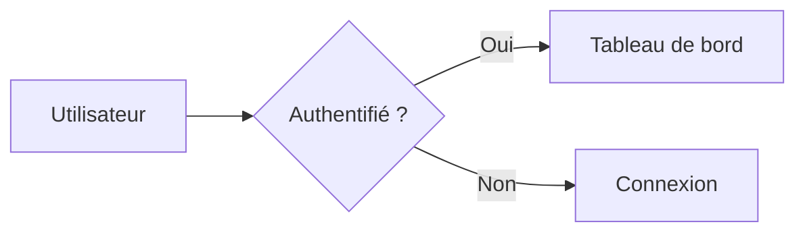
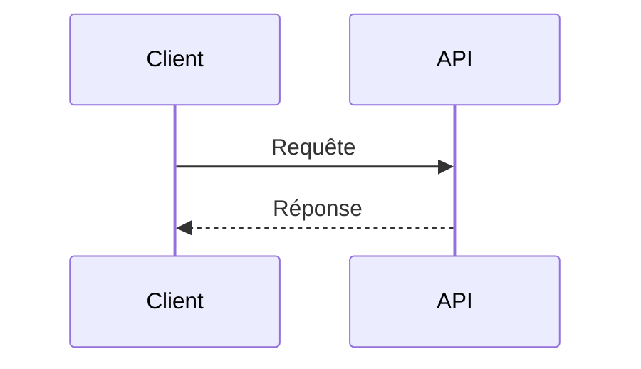

<style>
@import url('https://fonts.googleapis.com/css2?family=Noto+Sans+JP:wght@400;700&family=Fira+Code:wght@400;500;700&display=swap');

:root {
  --color-background: #0d1117;
  --color-foreground: #c9d1d9;
  --color-heading: #58a6ff;
  --color-accent: #7ee787;
  --color-code-bg: #161b22;
  --color-border: #30363d;
  --font-default: 'Noto Sans JP', 'Hiragino Kaku Gothic ProN', 'Meiryo', sans-serif;
  --font-code: 'Fira Code', 'Consolas', 'Monaco', monospace;
}

section {
  background-color: var(--color-background);
  color: var(--color-foreground);
  font-family: var(--font-default);
  font-weight: 400;
  box-sizing: border-box;
  border-left: 4px solid var(--color-accent);
  position: relative;
  line-height: 1.6;
  font-size: 20px;
  padding: 56px;
}

h1, h2, h3, h4, h5, h6 {
  font-weight: 700;
  color: var(--color-heading);
  margin: 0;
  padding: 0;
  font-family: var(--font-code);
}

h1 {
  font-size: 52px;
  line-height: 1.3;
  text-align: left;
}

h1::before {
  content: '# ';
  color: var(--color-accent);
}

h2 {
  font-size: 38px;
  margin-bottom: 40px;
  padding-bottom: 12px;
  border-bottom: 2px solid var(--color-border);
}

h2::before {
  content: '## ';
  color: var(--color-accent);
}

ul, ol {
  padding-left: 32px;
}

li {
  margin-bottom: 10px;
}

li::marker {
  color: var(--color-accent);
}

table {
  font-size: 18px;
  border-collapse: collapse;
}

th, td {
  border: 1px solid var(--color-border);
  padding: 8px 12px;
}

th {
  color: var(--color-heading);
  font-family: var(--font-code);
}

pre {
  background-color: var(--color-code-bg);
  border: 1px solid var(--color-border);
  border-radius: 6px;
  padding: 16px;
  overflow-x: auto;
  font-family: var(--font-code);
  font-size: 16px;
  line-height: 1.5;
}

code {
  background-color: var(--color-code-bg);
  color: var(--color-accent);
  padding: 2px 6px;
  border-radius: 3px;
  font-family: var(--font-code);
  font-size: 0.9em;
}

pre code {
  background-color: transparent;
  padding: 0;
  color: var(--color-foreground);
}

section.lead {
  border-left: 4px solid var(--color-accent);
  display: flex;
  flex-direction: column;
  justify-content: center;
}

section.lead h1 {
  margin-bottom: 24px;
}

section.lead p {
  font-size: 22px;
  color: var(--color-foreground);
  font-family: var(--font-code);
}

strong {
  color: var(--color-accent);
  font-weight: 700;
}
</style>

<!-- _class: lead -->

# Cheatsheets

Git / Maven / pnpm / Vite / Vitest / Storybook / Marp / MkDocs / Mermaid

.NET / Flutter / Python / Spring

Docker / Snowflake / GitHub Actions / Azure DevOps / MUI

Commandes depuis la racine du projet concerné, sauf indication contraire.
Noms de projets, workflows et identifiants à adapter.

---

## Git : examiner un dépôt

Site de référence : [Git](https://git-scm.com/)
Documentation : [Documentation Git](https://git-scm.com/docs)

**Prérequis :** Git 2.23+, dépôt local existant et identité de commit configurée.

```shell
git --version
git status --short
git --no-pager diff
git --no-pager log --oneline -5
```

`status` inclut les fichiers non suivis ; `diff` montre les modifications
non indexées des fichiers suivis.

---

## Git : créer une branche et valider

Depuis la branche de départ choisie, avec `README.md` modifié :

```shell
git switch -c feature/ma-fonctionnalite
git add README.md
git --no-pager diff --cached
git commit -m "Décrire la modification"
```

`add` prépare le contenu du prochain commit.
Vérifier `diff --cached` avant de valider.

Adapter le nom de la branche, le fichier et le message de commit.

---

## Git : synchroniser

**Prérequis :** dépôt distant `origin` configuré et accessible.
Publier la branche et définir son suivi :

```shell
git remote -v
git push -u origin feature/ma-fonctionnalite
```

Ensuite, sur cette branche et avec un arbre de travail propre :

```shell
git pull --ff-only
git push
```

`--ff-only` refuse une mise à jour si les historiques ont divergé :
analyser la situation plutôt que forcer le push.

---

## Git : préserver les modifications

Retirer un fichier de l'index sans modifier son contenu :

```shell
git restore --staged README.md
```

Mettre des modifications en cours de côté, puis les réappliquer :

```shell
git stash push -u -m "Travail en cours"
git stash list
git stash apply "stash@{0}"
```

`-u` inclut les fichiers non suivis, mais pas les fichiers ignorés.
`apply` conserve le stash ; résoudre les conflits avant de continuer.

---

## Git : mettre à jour

Vérifier la version installée avec `git --version`, puis la mettre à jour selon l'installation :

- Git for Windows : `git update-git-for-windows`
- macOS (Homebrew) : `brew upgrade git`
- Debian/Ubuntu (APT) : `sudo apt update && sudo apt install --only-upgrade git`

Sous Windows, fermer les terminaux et éditeurs qui utilisent Git avant la mise à jour.
Les dépôts locaux et la configuration (`~/.gitconfig`) sont conservés.

---

## Maven : compiler et tester

**Versions de référence (11 novembre 2026) :** JDK 25.0.5 (LTS) et Apache Maven 3.10.0.

**Prérequis :** JDK et Maven installés, projet avec `pom.xml`.

```shell
mvn --version
mvn clean compile
mvn test
mvn "-Dtest=UserServiceTest" test
mvn clean verify
mvn install
```

`verify` inclut les contrôles configurés jusqu'à cette phase.
`install` ajoute les artefacts au dépôt Maven local.

---

## Maven : diagnostiquer

Dépendances et configuration effective :

```shell
mvn dependency:tree
mvn help:effective-pom
mvn help:active-profiles
```

Module et profil à adapter ; dernière commande pour Spring Boot :

```shell
mvn -pl api -am verify
mvn -Pproduction package
mvn spring-boot:run
```

---

## Maven : mettre à jour

Mettre à jour l'installation locale de Maven :

- SDKMAN! (macOS, Linux, WSL) : `sdk upgrade maven`
- macOS (Homebrew) : `brew upgrade maven`
- Archive (Windows) : extraire la nouvelle archive et mettre à jour `PATH`

Fixer la version du Maven Wrapper, puis repérer les plugins et dépendances obsolètes :

```shell
mvn wrapper:wrapper "-Dmaven=3.10.0"
mvn versions:display-plugin-updates
mvn versions:display-dependency-updates
```

`wrapper:wrapper` met à jour `.mvn/wrapper/maven-wrapper.properties` : versionner ce fichier.

---

## pnpm : gérer les paquets

**Versions de référence (11 novembre 2026) :** Node.js 26.13.0 (LTS) et pnpm 12.18.0.

**Prérequis :** Node.js et pnpm installés.
Documentation : [Fast, disk space efficient package manager | pnpm](https://pnpm.io/fr)
Exemples de paquets : Axios 1.21.1 et TypeScript 7.0.2.
Pourquoi pnpm : [Motivation | pnpm](https://pnpm.io/fr/motivation)

```shell
pnpm --version
pnpm install
pnpm add axios
pnpm add -D typescript
pnpm remove axios
pnpm list --depth 0
pnpm why react
```

`add -D` déclare une dépendance de développement.

---

## pnpm : scripts et workspace

Scripts à définir dans `package.json` :

```shell
pnpm run dev
pnpm run build
pnpm run test
```

CI, paquet du workspace et exécution récursive :

```shell
pnpm install --frozen-lockfile
pnpm --filter mon-app run build
pnpm -r run test
pnpm exec tsc --noEmit
```

`tsc` nécessite TypeScript et un `tsconfig.json` adapté.

---

## pnpm : mettre à jour

Mettre à jour pnpm et, le cas échéant, la version épinglée dans `packageManager` :

```shell
pnpm self-update
pnpm runtime set node lts -g
```

Avec Homebrew, utiliser `brew upgrade pnpm` ; avec Corepack, `self-update` ne modifie que la version épinglée.
Si pnpm ne gère pas Node.js, utiliser l'installateur de Node.js au lieu de `runtime set`.

Mettre à jour les dépendances du projet :

```shell
pnpm outdated
pnpm update
pnpm update --latest
```

`update` respecte les plages de `package.json` ; `--latest` peut changer de version majeure.

---

## Vite : créer un projet

Site : [Vite](https://vite.dev/)
Guide : [Getting Started | Vite](https://vite.dev/guide/)

**Prérequis :** Node.js 20.19+ ou 22.12+, et pnpm installés.

Créer une application React avec TypeScript :

```shell
pnpm create vite mon-app --template react-ts
cd mon-app
pnpm install
```

Le guide officiel propose aussi des modèles JavaScript, Vue, Svelte et d’autres frameworks.

---

## Vite : développer

Depuis la racine du projet :

```shell
pnpm run dev
pnpm run dev -- --open
```

Le serveur démarre par défaut sur `http://localhost:5173`.

Vite recharge les modules modifiés pendant le développement. Arrêter le serveur avec `Ctrl+C`.

---

## Vite : compiler

Créer les fichiers optimisés pour la production :

```shell
pnpm run build
```

Vérifier localement le résultat généré dans `dist/` :

```shell
pnpm run preview
```

`preview` sert à contrôler le build localement ; ce n’est pas un serveur de production.

---

## Vite : configurer

Fichier `.env.local` :

```dotenv
VITE_API_URL=https://api.example.test
```

Lire la variable dans le code client :

```js
const apiUrl = import.meta.env.VITE_API_URL;
```

Toute variable `VITE_` est intégrée au code livré au navigateur : n’y placer aucun secret.
Le fichier `.env.local` est destiné aux réglages locaux et doit rester ignoré par Git.

---

## Vite : mettre à jour

Lire le [guide de migration](https://vite.dev/guide/migration) avant un changement de version majeure.

Depuis la racine du projet, vérifier Node.js, puis mettre à jour Vite et son plugin :

```shell
node --version
pnpm outdated vite @vitejs/plugin-react
pnpm update vite @vitejs/plugin-react --latest
pnpm run build
```

`@vitejs/plugin-react` correspond au modèle `react-ts` : adapter la liste aux plugins du projet.
Relancer ensuite `pnpm run dev` pour contrôler l'application.

---

## Vitest : installer

Site : [Vitest | Next Generation testing framework](https://vitest.dev/)
Guide : [Getting Started | Guide | Vitest](https://vitest.dev/guide/)

**Versions de référence (11 novembre 2026) :** Vitest et `@vitest/coverage-v8` 5.1.0, Node.js 26.13.0 (LTS).
Vitest nécessite Node.js 22.12.0 ou supérieur et Vite 6.4.0 ou supérieur.

Installer Vitest comme dépendance de développement :

```shell
pnpm add -D vitest
```

Ajouter le script de test à `package.json` :

```json
{
  "scripts": {
    "test": "vitest"
  }
}
```

---

## Vitest : écrire un test

Fonction à tester dans `src/sum.js` :

```js
export function sum(a, b) {
  return a + b;
}
```

Test dans `src/sum.test.js` :

```js
import { expect, test } from "vitest";
import { sum } from "./sum.js";

test("additionne deux nombres", () => {
  expect(sum(1, 2)).toBe(3);
});
```

---

## Vitest : lancer les tests

Depuis la racine du projet :

```shell
pnpm exec vitest run
pnpm exec vitest
pnpm exec vitest run src/sum.test.js
pnpm run test
node --run test
```

`vitest run` lance les tests une seule fois ; `vitest` les relance à chaque modification.
`node --run test` exécute le script `test` de `package.json` avec Node.js 22.13.0 ou supérieur.

Couverture de code avec le fournisseur V8 :

```shell
pnpm add -D @vitest/coverage-v8
pnpm exec vitest run --coverage
```

Garder `@vitest/coverage-v8` sur la même version majeure que Vitest.

---

## Vitest : mettre à jour

Lire le [guide de migration](https://vitest.dev/guide/migration) avant un changement de version majeure.

Mettre à jour Vitest et le fournisseur de couverture ensemble :

```shell
pnpm exec vitest --version
pnpm outdated vitest @vitest/coverage-v8
pnpm update vitest @vitest/coverage-v8 --latest
pnpm exec vitest run
```

Retirer `@vitest/coverage-v8` des commandes s'il n'est pas installé.
Vérifier aussi les versions de Node.js et de Vite exigées par la nouvelle version.

---

## Storybook : initialiser

Documentation : [Storybook: Frontend workshop for UI development](https://storybook.js.org/)
**Versions de référence (11 novembre 2026) :** Storybook 10.6.7, Node.js 26.13.0 (LTS) et pnpm 12.18.0.
Depuis un projet frontend existant, avec Node.js et pnpm :

```shell
pnpm create storybook@latest
pnpm run storybook
```

Choisir le framework lors de l'initialisation.
Le serveur s'ouvre habituellement sur `http://localhost:6006`.

Port personnalisé via le script généré :

```shell
pnpm run storybook --port 6007
```

---

## Storybook : exporter

Construire le catalogue statique :

```shell
pnpm run build-storybook
pnpm exec storybook build --output-dir dist/storybook
```

La première commande utilise le script généré.
La seconde est une alternative avec un dossier explicite.

Prévisualiser la sortie par défaut :

```shell
pnpm dlx serve storybook-static --listen 6006
```

---

## Storybook : mettre à jour

Depuis la racine du dépôt, mettre à jour tous les paquets Storybook :

```shell
pnpm dlx storybook@latest upgrade
pnpm run build-storybook
```

La commande applique les automigrations, puis lance un contrôle de santé.

Elle ne franchit qu'une version majeure à la fois : depuis Storybook 8,
lancer `pnpm dlx storybook@9 upgrade`, puis `pnpm dlx storybook@latest upgrade`.

Guide : [Upgrading Storybook](https://storybook.js.org/docs/releases/upgrading)

---

## .NET : créer et exécuter

**Versions de référence (11 novembre 2026) :** SDK .NET 11.0.100 (STS) et 10.0.404 (LTS).

**Prérequis :** SDK .NET installé.

```shell
dotnet --info
dotnet new list
dotnet new webapi -n Demo.Api
dotnet restore Demo.Api
dotnet build Demo.Api --no-restore
dotnet run --project Demo.Api
```

Rechargement pendant le développement :

```shell
dotnet watch --project Demo.Api run
```

---

## .NET : tester et publier

Créer un projet xUnit et référencer l'API :

```shell
dotnet new xunit -n Demo.Tests
dotnet add Demo.Tests reference Demo.Api
dotnet test Demo.Tests
dotnet test Demo.Tests --filter "FullyQualifiedName~UserTests"
```

Publication Release et dépendances obsolètes :

```shell
dotnet publish Demo.Api -c Release -o artifacts/api
dotnet list Demo.Api package --outdated
```

Le filtre suppose que des tests `UserTests` ont été ajoutés.

---

## .NET : mettre à jour

Comparer les SDK et runtimes installés aux dernières versions publiées :

```shell
dotnet --list-sdks
dotnet sdk check
```

Sous Windows, mettre à jour .NET 10 ou installer .NET 11 :

```shell
winget upgrade --id Microsoft.DotNet.SDK.10 --source winget
winget install --id Microsoft.DotNet.SDK.11 --source winget
```

Sous macOS/Linux, utiliser l'installateur ou le gestionnaire de paquets d'origine.
Pour changer de version majeure, modifier `<TargetFramework>` (par exemple `net11.0`)
et `global.json` s'il existe, puis lancer `dotnet build` et `dotnet test`.

---

## Flutter : démarrer

Site de référence : [Flutter](https://flutter.dev/)
Documentation : [Documentation Flutter](https://docs.flutter.dev/)

**Prérequis :** SDK Flutter installé (Dart inclus) et outils de la plateforme ciblée.

```shell
flutter --version
flutter doctor
flutter create mon_app
cd mon_app
```

Corriger les prérequis signalés par `flutter doctor` pour la plateforme visée.
Les commandes suivantes s'exécutent depuis la racine du projet.

---

## Flutter : exécuter

Avec un appareil connecté ou un émulateur lancé :

```shell
flutter devices
flutter run
```

Alternative web, avec Chrome installé :

```shell
flutter run -d chrome
```

En mode débogage : `r` recharge à chaud, `R` redémarre
et `q` arrête l'exécution.

---

## Flutter : dépendances et tests

Ajouter un paquet, récupérer les dépendances et vérifier les mises à jour :

```shell
flutter pub add http
flutter pub get
flutter pub outdated
```

Formater le code, l'analyser et lancer les tests unitaires et de widgets :

```shell
dart format .
flutter analyze
flutter test
```

---

## Flutter : compiler

Choisir la commande correspondant à la plateforme ciblée :

```shell
flutter build apk --release
flutter build appbundle --release
flutter build web --release
flutter build ipa --release
```

- **Android :** SDK Android requis ; configurer la signature avant publication.
- **Web :** les fichiers générés se trouvent dans `build/web`.
- **iOS :** macOS, Xcode et une configuration de signature sont nécessaires.

---

## Flutter : mettre à jour

Mettre à jour le SDK Flutter, Dart inclus, sur le canal courant :

```shell
flutter channel
flutter upgrade
```

Puis, depuis la racine du projet :

```shell
flutter pub upgrade
flutter pub upgrade --major-versions
dart fix --apply
flutter test
```

`--major-versions` modifie les contraintes de `pubspec.yaml`.
Consulter les [changements incompatibles](https://docs.flutter.dev/release/breaking-changes)
et vérifier les modifications de `dart fix` avant de les valider.

---

## Python : exécuter

Documentation : [Documentation de Python 3.15.2](https://docs.python.org/3/)
Site de référence : [Python.org](https://www.python.org/)

**Version de référence (11 novembre 2026) :** Python 3.15.2.

**Prérequis :** Python 3 installé. Utiliser `python3` si nécessaire sous macOS/Linux.

```shell
python --version
python script.py
python -c "print('Bonjour !')"
```

`script.py` doit exister. `python` seul ouvre l'interpréteur interactif ;
`exit()` permet de le quitter.

---

## Python : isoler le projet

Créer et activer un environnement virtuel sous Windows (PowerShell) :

```powershell
python -m venv .venv
.\.venv\Scripts\Activate.ps1
```

Sous macOS/Linux (bash, zsh) :

```shell
python3 -m venv .venv
source .venv/bin/activate
```

Une fois activé, `python` et `python -m pip` ciblent cet environnement.
`deactivate` permet d'en sortir. Ne pas versionner `.venv`.

---

## Python : gérer les paquets

Dans l'environnement virtuel activé :

```shell
python -m pip install requests
python -m pip install --upgrade requests
python -m pip list
python -m pip check
python -m pip uninstall requests
```

Installer les dépendances depuis un fichier `requirements.txt` existant :

```shell
python -m pip install -r requirements.txt
```

---

## Python : lancer les tests

**Prérequis :** des tests `unittest` existants dans le dossier `tests`.
`unittest` fait partie de la bibliothèque standard de Python.

Découvrir et exécuter tous les fichiers `test_*.py` :

```shell
python -m unittest discover -s tests -v
```

Cibler un fichier de tests :

```shell
python -m unittest discover -s tests -p "test_calcul.py" -v
```

Adapter `tests` et `test_calcul.py` au projet.
L'option `-v` affiche le détail des tests exécutés.

---

## Python : mettre à jour

Sous Windows, avec le gestionnaire d'installation Python :

```powershell
py list
py install --update
```

`--update` met à jour les versions gérées par `py` ; `py install 3.15` installe une version précise.
Sous macOS/Linux, utiliser l'installateur de python.org, Homebrew ou le gestionnaire de paquets.

Après un changement de version mineure, désactiver puis recréer `.venv`,
le réactiver et réinstaller les dépendances :

```shell
python -m venv --clear .venv
python -m pip install --upgrade pip
python -m pip install -r requirements.txt
```

---

## Spring : démarrer

Site de référence : [Spring](https://spring.io/)
Documentation : [Spring Boot](https://docs.spring.io/spring-boot/)

**Version de référence (11 novembre 2026) :** Spring Boot 4.1.2.
**Prérequis :** JDK 17+ et Maven 3.6.3+.

Sur [Spring Initializr](https://start.spring.io/), choisir **Maven**, **Java** et **Spring Web**.
Générer le projet, extraire l'archive et ouvrir sa racine dans le terminal.

```shell
mvn spring-boot:run
```

Le serveur web écoute sur le port `8080` par défaut.

---

## Spring : configurer

Exemple dans `src/main/resources/application.yml` :

```yaml
spring:
  application:
    name: demo
server:
  port: 8081
```

Activer un profil au démarrage :

```shell
mvn spring-boot:run "-Dspring-boot.run.profiles=dev"
```

`application-dev.yml`, placé dans le même dossier, complète la configuration
lorsque le profil `dev` est actif.

---

## Spring : tester et empaqueter

Tester et créer le JAR exécutable :

```shell
mvn test
mvn clean verify
```

Exécuter le JAR généré (nom à adapter au projet) :

```shell
java -jar target/demo-0.0.1-SNAPSHOT.jar
java -jar target/demo-0.0.1-SNAPSHOT.jar --spring.profiles.active=dev
```

Sans Maven installé, utiliser le wrapper fourni par le projet :
remplacer `mvn` par `.\mvnw.cmd` sous Windows ou `./mvnw` sous macOS/Linux.

---

## Spring : mettre à jour

Lister les versions disponibles du parent Spring Boot :

```shell
mvn versions:display-parent-updates
```

Modifier la version du parent dans `pom.xml` :

```xml
<parent>
  <groupId>org.springframework.boot</groupId>
  <artifactId>spring-boot-starter-parent</artifactId>
  <version>4.1.2</version>
</parent>
```

Adapter la propriété `java.version` si nécessaire, puis lancer `mvn clean verify`.
Lire les notes de version et guides de migration du [wiki Spring Boot](https://github.com/spring-projects/spring-boot/wiki).

---

## Docker : démarrer

Site de référence : [Docker](https://www.docker.com/)
Documentation : [Documentation Docker](https://docs.docker.com/)

**Prérequis :** Docker installé, moteur démarré et conteneurs Linux activés.

```shell
docker version
docker pull nginx:alpine
docker run --name demo-web -d -p 127.0.0.1:8080:80 nginx:alpine
```

Le site est accessible sur `http://localhost:8080`, uniquement depuis l'hôte.
Adapter le nom du conteneur et le port s'ils sont déjà utilisés.

---

## Docker : suivre un conteneur

Lister les conteneurs, lire les journaux et ouvrir un shell :

```shell
docker ps -a
docker logs --tail 50 demo-web
docker exec -it demo-web sh
```

Quitter le shell avec `exit`, puis arrêter ou relancer le conteneur :

```shell
docker stop demo-web
docker start demo-web
```

`stop` et `start` réutilisent le même conteneur sans le supprimer.

---

## Docker : construire une image

**Prérequis :** `Dockerfile` existant à la racine du projet ;
application écoutant sur `0.0.0.0:8080` dans le conteneur.

```shell
docker build -t mon-app:dev .
docker image ls
docker run --rm -p 127.0.0.1:8081:8080 mon-app:dev
```

`--rm` supprime le conteneur à son arrêt.
Conserver les données persistantes dans un volume.

Utiliser `.dockerignore` pour exclure les fichiers inutiles et les secrets
du contexte de construction.

---

## Docker : utiliser Compose

**Prérequis :** Docker Compose installé et fichier `compose.yaml` existant.
Exécuter les commandes depuis le dossier contenant ce fichier :

```shell
docker compose config --quiet
docker compose up -d --build
docker compose ps
docker compose logs --tail 50
docker compose down
```

**Attention :** `down` supprime les conteneurs et réseaux du projet.
Les volumes nommés sont conservés, mais pas les données stockées uniquement
dans les conteneurs.

---

## Docker : exemple de compose.yaml

Fichier `compose.yaml` avec un service, un port, un redémarrage automatique,
un contrôle de santé et un volume :

Avant le démarrage, créer à côté de `compose.yaml` le dossier `html` et y placer
un fichier `index.html` ; le montage de `./html` masque le contenu fourni par
l’image Nginx.

```yaml
services:
  web:
    image: nginx:1.27-alpine
    ports:
      - "127.0.0.1:8080:80"
    restart: unless-stopped
    healthcheck:
      test: ["CMD", "wget", "-q", "--spider", "http://localhost/"]
      interval: 30s
      timeout: 5s
      retries: 3
      start_period: 10s
    volumes:
      - ./html:/usr/share/nginx/html:ro
      - web-data:/var/cache/nginx

volumes:
  web-data:
```

`./html` est monté en lecture seule ; `web-data` est un volume nommé persistant.
Vérifier l'état avec `docker compose ps`.

---

## Docker : mettre à jour

Docker Desktop : vérifier, puis installer les mises à jour (ou **Settings > Software updates**) :

```shell
docker version
docker desktop update --check-only
docker desktop update
```

Sous Linux, mettre à jour les paquets Docker Engine avec le gestionnaire de paquets.

Récupérer les images récentes, puis recréer les conteneurs concernés :

```shell
docker compose pull
docker compose up -d
docker build --pull -t mon-app:dev .
```

Pour une étiquette figée (`nginx:1.27-alpine`), modifier d'abord `compose.yaml`.

---

## Snowflake : choisir le contexte

Site de référence : [Snowflake](https://www.snowflake.com/)
Documentation : [Documentation Snowflake](https://docs.snowflake.com/)

**Prérequis :** compte Snowflake, accès SQL via Snowsight et objets de test autorisés.

```sql
USE ROLE MON_ROLE;
USE WAREHOUSE MON_WH;
USE DATABASE MON_DB;
USE SCHEMA MON_SCHEMA;
SELECT CURRENT_ROLE(), CURRENT_WAREHOUSE(), CURRENT_DATABASE(), CURRENT_SCHEMA();
```

Adapter `MON_ROLE`, `MON_WH`, `MON_DB` et `MON_SCHEMA`
à des rôles et objets existants.

---

## Snowflake : explorer les données

Lister les objets visibles par le rôle actif :

```sql
SHOW DATABASES;
SHOW SCHEMAS IN DATABASE MON_DB;
SHOW TABLES IN SCHEMA MON_DB.MON_SCHEMA;
DESCRIBE TABLE MON_DB.MON_SCHEMA.MA_TABLE;
```

Lire un extrait d'une table existante :

```sql
SELECT * FROM MON_DB.MON_SCHEMA.MA_TABLE LIMIT 10;
```

Adapter `MA_TABLE` et vérifier les droits de lecture sur cette table.

---

## Snowflake : charger un CSV

**Prérequis :** `clients.csv` (en-tête `ID,NOM`) déposé dans le stage `MON_STAGE`,
avec les droits de lecture du stage et d'accès au schéma.

```sql
CREATE TEMP TABLE TMP_CLIENTS_DEMO (ID NUMBER, NOM VARCHAR);
COPY INTO TMP_CLIENTS_DEMO FROM @MON_STAGE
FILES = ('clients.csv')
FILE_FORMAT = (TYPE = CSV SKIP_HEADER = 1
               FIELD_OPTIONALLY_ENCLOSED_BY = '"')
ON_ERROR = 'ABORT_STATEMENT';
SELECT * FROM TMP_CLIENTS_DEMO LIMIT 10;
```

La table temporaire est limitée à la session courante.
Une erreur de chargement interrompt l'instruction `COPY INTO`.

---

## Snowflake : suivre le calcul

Consulter les dernières requêtes de la session (durées en millisecondes) :

```sql
SELECT QUERY_ID, EXECUTION_STATUS, TOTAL_ELAPSED_TIME
FROM TABLE(INFORMATION_SCHEMA.QUERY_HISTORY_BY_SESSION(RESULT_LIMIT => 5))
ORDER BY START_TIME DESC;
```

Sur un entrepôt de test, avec le droit `MODIFY` :

```sql
ALTER WAREHOUSE MON_WH SET AUTO_SUSPEND = 60 AUTO_RESUME = TRUE;
```

Auto-suspension après inactivité (seuil de 60 secondes), reprise au besoin.
Un entrepôt démarré consomme des crédits, même sans requête en cours.

---

## Snowflake : mettre à jour

Snowflake met à jour le service et Snowsight automatiquement.
Afficher la version du compte :

```sql
SELECT CURRENT_VERSION();
```

Mettre à jour les clients locaux selon leur mode d'installation :

```shell
snow upgrade
uv tool upgrade snowflake-cli
brew upgrade snowflake-cli
python -m pip install --upgrade snowflake-connector-python
```

`snow upgrade` concerne l'installateur autonome de Snowflake CLI
et reste sur la même version majeure.
Mettre à jour le connecteur Python dans l'environnement virtuel du projet.

---

## GitHub Actions : lancer

**Version de référence (11 novembre 2026) :** GitHub CLI (`gh`) 2.103.3.

**Prérequis :** GitHub CLI (`gh`), accès au dépôt et workflow existant.

```shell
gh auth login
gh workflow list
gh workflow view ci.yml
gh workflow run ci.yml --ref main
gh run list --workflow ci.yml --limit 5
```

Exécuter depuis le clone du dépôt.
Le lancement manuel exige `workflow_dispatch` dans le workflow.

---

## GitHub Actions : suivre

Remplacer `123456789` par un identifiant retourné par `gh run list`.

```shell
gh run watch 123456789 --exit-status
gh run view 123456789 --log-failed
gh run rerun 123456789 --failed
gh run download 123456789 --dir artifacts
```

`watch --exit-status` signale un échec via le code de sortie.
Le téléchargement suppose des artefacts publiés par le workflow.

---

## GitHub Actions : mettre à jour

Vérifier la version de GitHub CLI avec `gh --version`, puis la mettre à jour :

- Windows (WinGet) : `winget upgrade --id GitHub.cli --source winget`
- macOS (Homebrew) : `brew upgrade gh`
- Debian/Ubuntu (APT) : `sudo apt update && sudo apt install gh`

Faire proposer les nouvelles versions des actions (`uses:`) par Dependabot,
dans `.github/dependabot.yml` :

```yaml
version: 2
updates:
  - package-ecosystem: "github-actions"
    directory: "/"
    schedule:
      interval: "weekly"
```

---

## Azure DevOps : configurer

**Versions de référence (11 novembre 2026) :** Azure CLI 2.92.0, extension Azure DevOps 1.0.10.

**Prérequis :** Azure CLI et accès à l'organisation Azure DevOps.

```shell
az extension add --name azure-devops
az login
az devops configure --defaults organization=https://dev.azure.com/mon-org project=mon-projet
az pipelines list --output table
```

Lancer une pipeline existante sur une branche :

```shell
az pipelines run --name ma-pipeline --branch main
```

---

## Azure DevOps : suivre

Reprendre la configuration de la slide précédente.
Remplacer `42` par l'ID de pipeline et `1234` par l'ID d'exécution.

```shell
az pipelines runs list --pipeline-ids 42 --top 5 -o table
az pipelines runs show --id 1234 --output table
az pipelines runs show --id 1234 --open
az pipelines runs artifact list --run-id 1234 -o table
az pipelines runs artifact download --run-id 1234 --artifact-name drop --path artifacts
```

`--open` ouvre le suivi et les logs dans le navigateur.
`drop` doit correspondre à un artefact publié par la pipeline.

---

## Azure DevOps : mettre à jour

Vérifier les versions, puis mettre à jour Azure CLI et ses extensions :

```shell
az version
az upgrade
az extension update --name azure-devops
```

`az upgrade` met aussi à jour les extensions installées ; la dernière commande
ne met à jour que l'extension Azure DevOps.

Activer la mise à jour automatique, désactivée par défaut :

```shell
az config set auto-upgrade.enable=yes
```

---

## MUI : installer

**Versions de référence (11 novembre 2026) :** Node.js 26.13.0 (LTS), pnpm 12.18.0, React 19.3.1, `@mui/material` et `@mui/icons-material` 9.5.0, MUI X 9.17.0.
Dépendances de l'exemple : Emotion (`@emotion/react` 11.14.0, `@emotion/styled` 11.14.1) et Day.js 1.11.23.

Depuis une application React existante, avec pnpm :

```shell
pnpm add @mui/material @emotion/react @emotion/styled
pnpm add @mui/icons-material
```

Bibliothèques optionnelles pour tableaux et dates :

```shell
pnpm add @mui/x-data-grid
pnpm add @mui/x-date-pickers dayjs
```

Les sélecteurs de date exigent un `LocalizationProvider`
et un adaptateur tel que `AdapterDayjs`.

---

## MUI : composants

Exemple React à placer dans un fichier `.tsx` ou `.jsx` :

```jsx
import { Button, Stack, TextField } from "@mui/material";
import SaveIcon from "@mui/icons-material/Save";

export default function Formulaire() {
  return (
    <Stack component="form" spacing={2} sx={{ maxWidth: 360 }}>
      <TextField name="nom" label="Nom" required fullWidth />
      <Button type="submit" variant="contained" startIcon={<SaveIcon />}>
        Enregistrer
      </Button>
    </Stack>
  );
}
```

Ajouter un gestionnaire `onSubmit` pour persister les données.

---

## MUI : mettre à jour

Avant un changement de version majeure, remplacer les API dépréciées,
puis suivre le [guide de migration](https://mui.com/material-ui/migration/upgrade-to-v9/) :

```shell
pnpm dlx @mui/codemod@latest deprecations/all src
```

Mettre à jour ensemble les paquets MUI du projet :

```shell
pnpm outdated "@mui/*"
pnpm update "@mui/*" --latest
```

Vérifier le diff avec Git, puis lancer les tests et le build.

---

## Marp : écrire des diapositives

Site : [Marp | The Markdown Presentation Ecosystem](https://marp.app/)
CLI : [marp-team/marp-cli](https://github.com/marp-team/marp-cli)
Directives : [Marpit Directives](https://marpit.marp.app/directives)

**Version de référence (11 novembre 2026) :** Marp CLI 4.5.1 et Node.js 26.13.0 (LTS).
Marp CLI nécessite Node.js 18 ou supérieur.

En-tête YAML et séparation des diapositives :

```markdown
---
marp: true
theme: default
paginate: true
---

# Titre

---

## Diapositive suivante
```

---

## Marp : exporter

Installer le CLI dans le projet :

```shell
pnpm add -D @marp-team/marp-cli
```

Exporter en HTML, PDF et PowerPoint :

```shell
pnpm exec marp src/presentation.md --html --output dist/presentation.html
pnpm exec marp src/presentation.md --html --pdf --pdf-outlines --output dist/presentation.pdf
pnpm exec marp src/presentation.md --html --pptx --output dist/presentation.pptx
pnpm exec marp src/presentation.md --html --images png --output dist/presentation.png
```

L'export PDF, PPTX et images nécessite Chrome, Edge ou Firefox.

---

## Marp : prévisualiser

Prévisualiser un dossier ou surveiller une source :

```shell
pnpm exec marp --server src
pnpm exec marp --watch src/presentation.md
```

Dans ce dépôt :

```shell
pnpm run dev
make build
```

`make build` génère les exports HTML, PDF et PPTX des thématiques.

Thèmes intégrés : `default`, `gaia` et `uncover`.
`<!-- _class: lead -->` applique une classe à la diapositive courante.

---

## Marp : mettre à jour

Vérifier, puis mettre à jour Marp CLI dans le projet :

```shell
pnpm exec marp --version
pnpm outdated @marp-team/marp-cli
pnpm update @marp-team/marp-cli --latest
```

Dans ce dépôt, régénérer ensuite les exports pour contrôler le rendu :

```shell
make build
```

L'extension **Marp for VS Code** se met à jour depuis la vue Extensions.
Consulter les [notes de version](https://github.com/marp-team/marp-cli/releases).

---

## MkDocs : installer

Site : [MkDocs](https://www.mkdocs.org/)
Guide : [Getting Started with MkDocs](https://www.mkdocs.org/getting-started/)

**Version de référence (11 novembre 2026) :** MkDocs 1.6.1.
MkDocs nécessite Python 3.8 ou supérieur.

**Prérequis :** environnement virtuel Python activé (voir la fiche Python).

```shell
python -m pip install mkdocs
mkdocs --version
mkdocs --help
```

Sous Windows, utiliser `python -m mkdocs` si la commande `mkdocs` est introuvable.

---

## MkDocs : créer et prévisualiser

Créer un projet, puis lancer le serveur de développement :

```shell
mkdocs new mon-site
cd mon-site
mkdocs serve
```

`mkdocs new` crée la configuration `mkdocs.yml` et la page `docs/index.md`.

Le site est servi sur `http://127.0.0.1:8000/` et se recharge à chaque modification
de `docs/` ou de `mkdocs.yml`. Arrêter le serveur avec `Ctrl+C`.

---

## MkDocs : configurer

Fichier `mkdocs.yml` à la racine du projet :

```yaml
site_name: Mon projet
nav:
  - Accueil: index.md
  - À propos: about.md
theme: readthedocs
```

`site_name` est la seule option obligatoire.
Les pages listées dans `nav` doivent exister dans `docs/` : créer `docs/about.md` avant de l'ajouter.
Thèmes intégrés : `mkdocs` (par défaut) et `readthedocs`.

---

## MkDocs : générer et publier

Générer le site statique dans `site/`, en échouant au moindre avertissement :

```shell
mkdocs build --strict
```

Ajouter `site/` au `.gitignore` : ce dossier est régénéré à chaque build.

Publier sur GitHub Pages, dans la branche `gh-pages` du distant `origin` :

```shell
mkdocs gh-deploy
```

`gh-deploy` publie sans relecture et inclut les fichiers non suivis ou non validés :
vérifier le site avant, et ne jamais modifier la branche `gh-pages` à la main.

---

## MkDocs : mettre à jour

Dans l'environnement virtuel activé :

```shell
python -m pip list --outdated
python -m pip install --upgrade mkdocs
mkdocs --version
```

Mettre aussi à jour les thèmes et extensions installés séparément,
puis reporter les nouvelles versions dans `requirements.txt` s'il existe.

Vérifier le site avant de le publier :

```shell
mkdocs build --strict
```

Consulter les [notes de version](https://www.mkdocs.org/about/release-notes/).

---

## Mermaid : écrire un diagramme

Site : [Mermaid](https://mermaid.js.org/)
Syntaxe : [Flowcharts](https://mermaid.js.org/syntax/flowchart.html)

Déclarer le type et l'orientation, puis relier les nœuds :



`LR` oriente le flux de gauche à droite ; `TD` le fait descendre.
Les identifiants désignent les nœuds ; les libellés entre crochets s'affichent.
Dans un flowchart, éviter le mot `end` en minuscules : il peut casser le diagramme.

---

## Mermaid : choisir un type

- **Flowchart** : étapes, décisions et enchaînements.
- **Sequence** : échanges ordonnés entre acteurs ou services.
- **Class** et **ER** : structures de classes et relations entre entités.
- **State** : états et transitions d'un système.
- **Gantt** : tâches et calendrier d'un projet.
- **Mindmap**, **Timeline**, **Pie** et **Git graph** : idées, événements,
  proportions et historique de branches.

Chaque type a sa propre syntaxe : consulter la
[référence des diagrammes](https://mermaid.js.org/intro/syntax-reference.html).

---

## Mermaid : intégrer dans Markdown

Dans les plateformes compatibles, utiliser un bloc de code `mermaid` :

````markdown

````

GitHub et GitLab rendent ces blocs. Le rendu dépend toutefois de la plateforme
et de sa configuration : vérifier le résultat dans l'outil cible.

---

## Mermaid : prévisualiser et exporter

Ouvrir l'[éditeur Mermaid Live](https://mermaid.live/) pour saisir le code et
contrôler le rendu au fil des modifications.

Depuis l'éditeur, exporter le diagramme en PNG, SVG ou Markdown. Conserver le
code source pour pouvoir le modifier et le suivre avec Git.

En cas d'erreur, vérifier le mot-clé du diagramme, les identifiants de nœuds et
les caractères réservés dans les libellés.

---

## Mermaid : mettre à jour

Mermaid Live, GitHub et GitLab intègrent leur propre version de Mermaid,
mise à jour par chaque plateforme.

Dans un projet JavaScript :

```shell
pnpm list mermaid
pnpm update mermaid --latest
```

Sur une page web, changer la version majeure dans l'import CDN :

```js
import mermaid from "https://cdn.jsdelivr.net/npm/mermaid@12/dist/mermaid.esm.min.mjs";
```

Après une mise à jour, vérifier le rendu des diagrammes existants.
