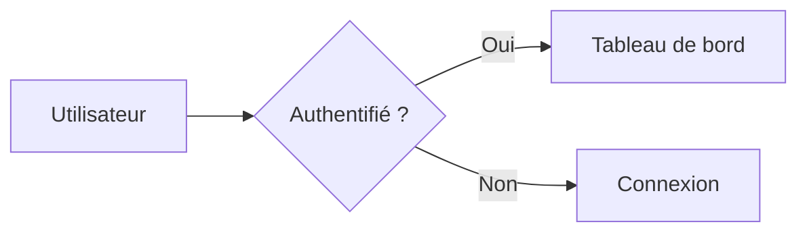
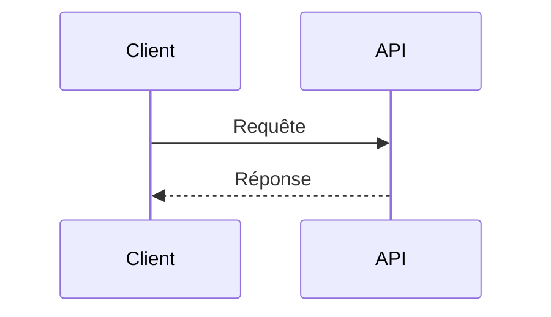

<style>
@import url('https://fonts.googleapis.com/css2?family=Noto+Sans+JP:wght@400;700&family=Fira+Code:wght@400;500;700&display=swap');

:root {
  --color-background: #0d1117;
  --color-foreground: #c9d1d9;
  --color-heading: #58a6ff;
  --color-accent: #7ee787;
  --color-code-bg: #161b22;
  --color-border: #30363d;
  --font-default: 'Noto Sans JP', 'Hiragino Kaku Gothic ProN', 'Meiryo', sans-serif;
  --font-code: 'Fira Code', 'Consolas', 'Monaco', monospace;
}

section {
  background-color: var(--color-background);
  color: var(--color-foreground);
  font-family: var(--font-default);
  font-weight: 400;
  box-sizing: border-box;
  border-left: 4px solid var(--color-accent);
  position: relative;
  line-height: 1.6;
  font-size: 20px;
  padding: 56px;
}

h1, h2, h3, h4, h5, h6 {
  font-weight: 700;
  color: var(--color-heading);
  margin: 0;
  padding: 0;
  font-family: var(--font-code);
}

h1 {
  font-size: 52px;
  line-height: 1.3;
  text-align: left;
}

h1::before {
  content: '# ';
  color: var(--color-accent);
}

h2 {
  font-size: 38px;
  margin-bottom: 40px;
  padding-bottom: 12px;
  border-bottom: 2px solid var(--color-border);
}

h2::before {
  content: '## ';
  color: var(--color-accent);
}

ul, ol {
  padding-left: 32px;
}

li {
  margin-bottom: 10px;
}

li::marker {
  color: var(--color-accent);
}

table {
  font-size: 18px;
  border-collapse: collapse;
}

th, td {
  border: 1px solid var(--color-border);
  padding: 8px 12px;
}

th {
  color: var(--color-heading);
  font-family: var(--font-code);
}

pre {
  background-color: var(--color-code-bg);
  border: 1px solid var(--color-border);
  border-radius: 6px;
  padding: 16px;
  overflow-x: auto;
  font-family: var(--font-code);
  font-size: 16px;
  line-height: 1.5;
}

code {
  background-color: var(--color-code-bg);
  color: var(--color-accent);
  padding: 2px 6px;
  border-radius: 3px;
  font-family: var(--font-code);
  font-size: 0.9em;
}

pre code {
  background-color: transparent;
  padding: 0;
  color: var(--color-foreground);
}

section.lead {
  border-left: 4px solid var(--color-accent);
  display: flex;
  flex-direction: column;
  justify-content: center;
}

section.lead h1 {
  margin-bottom: 24px;
}

section.lead p {
  font-size: 22px;
  color: var(--color-foreground);
  font-family: var(--font-code);
}

strong {
  color: var(--color-accent);
  font-weight: 700;
}
</style>

<!-- _class: lead -->

# Mermaid

Créer des diagrammes à partir de texte et les intégrer à la documentation.

---

## Mermaid : écrire un diagramme

Site : [Mermaid](https://mermaid.js.org/)
Syntaxe : [Flowcharts](https://mermaid.js.org/syntax/flowchart.html)

Déclarer le type et l'orientation, puis relier les nœuds :



`LR` oriente le flux de gauche à droite ; `TD` le fait descendre.
Les identifiants désignent les nœuds ; les libellés entre crochets s'affichent.
Dans un flowchart, éviter le mot `end` en minuscules : il peut casser le diagramme.

---

## Mermaid : choisir un type

- **Flowchart** : étapes, décisions et enchaînements.
- **Sequence** : échanges ordonnés entre acteurs ou services.
- **Class** et **ER** : structures de classes et relations entre entités.
- **State** : états et transitions d'un système.
- **Gantt** : tâches et calendrier d'un projet.
- **Mindmap**, **Timeline**, **Pie** et **Git graph** : idées, événements,
  proportions et historique de branches.

Chaque type a sa propre syntaxe : consulter la
[référence des diagrammes](https://mermaid.js.org/intro/syntax-reference.html).

---

## Mermaid : intégrer dans Markdown

Dans les plateformes compatibles, utiliser un bloc de code `mermaid` :

````markdown

````

GitHub et GitLab rendent ces blocs. Le rendu dépend toutefois de la plateforme
et de sa configuration : vérifier le résultat dans l'outil cible.

---

## Mermaid : prévisualiser et exporter

Ouvrir l'[éditeur Mermaid Live](https://mermaid.live/) pour saisir le code et
contrôler le rendu au fil des modifications.

Depuis l'éditeur, exporter le diagramme en PNG, SVG ou Markdown. Conserver le
code source pour pouvoir le modifier et le suivre avec Git.

En cas d'erreur, vérifier le mot-clé du diagramme, les identifiants de nœuds et
les caractères réservés dans les libellés.

---

## Mermaid : mettre à jour

Mermaid Live, GitHub et GitLab intègrent leur propre version de Mermaid,
mise à jour par chaque plateforme.

Dans un projet JavaScript :

```shell
pnpm list mermaid
pnpm update mermaid --latest
```

Sur une page web, changer la version majeure dans l'import CDN :

```js
import mermaid from "https://cdn.jsdelivr.net/npm/mermaid@12/dist/mermaid.esm.min.mjs";
```

Après une mise à jour, vérifier le rendu des diagrammes existants.
